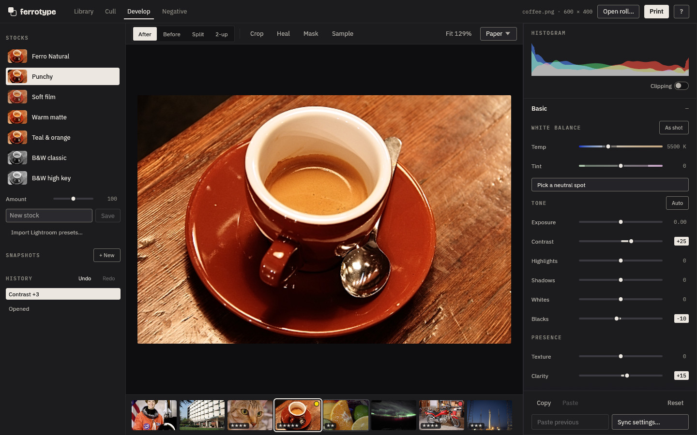
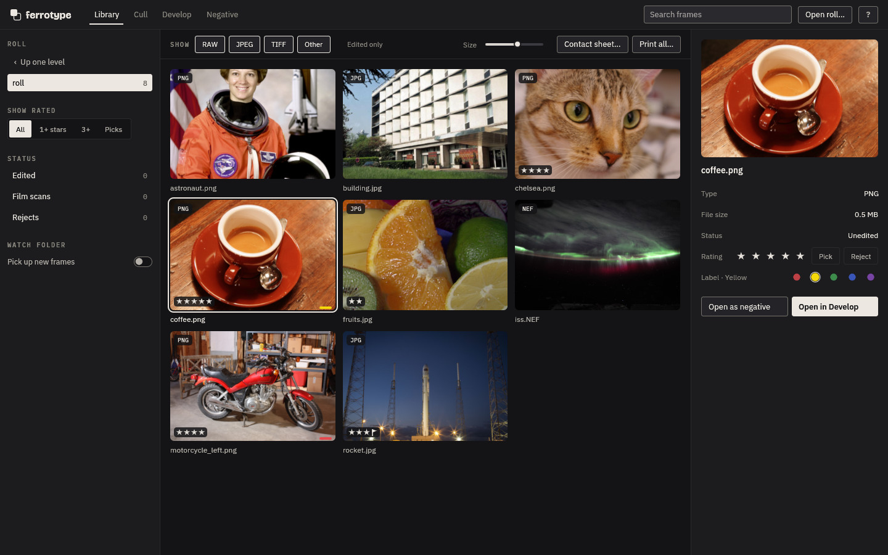
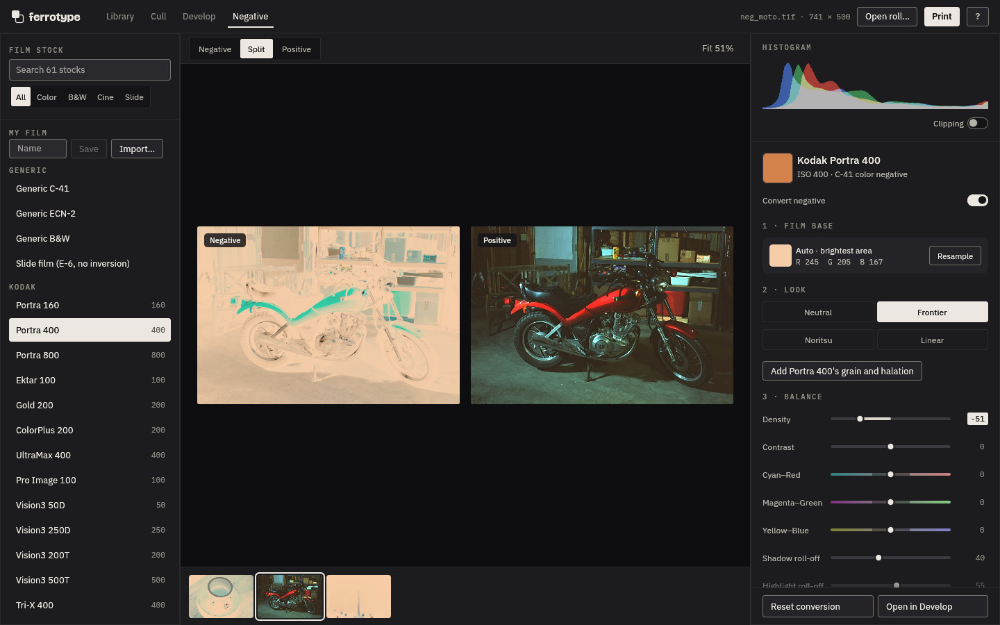
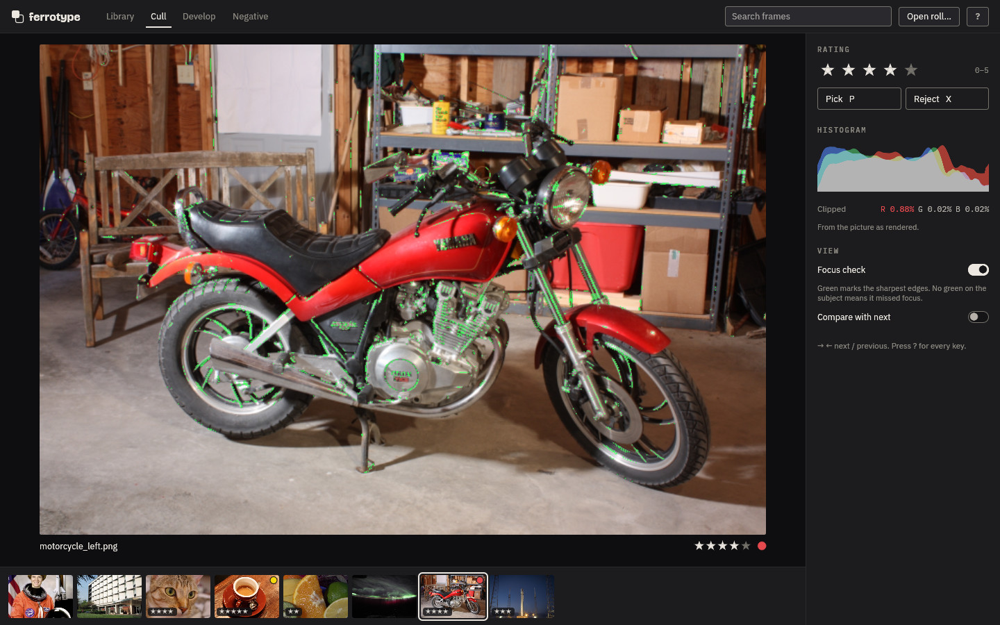
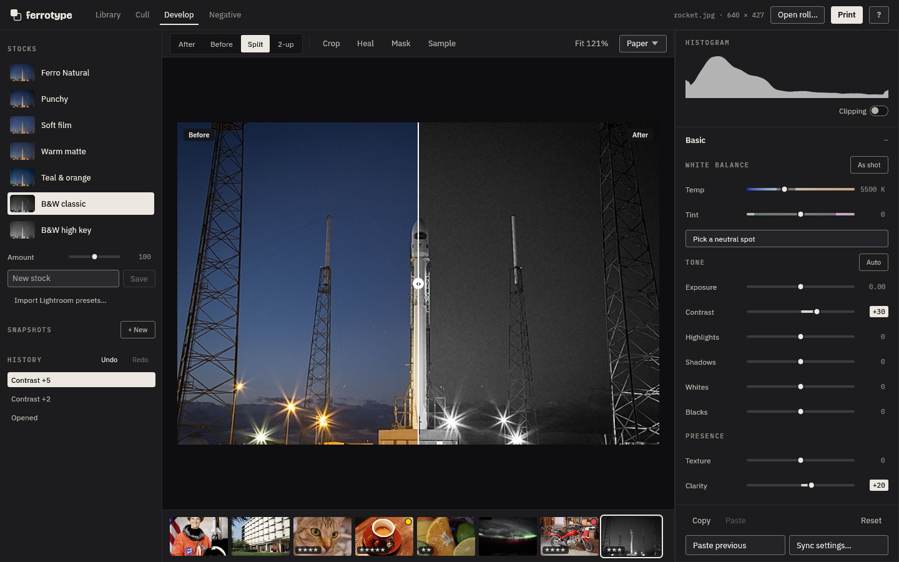

<p align="center">
  <picture>
    <source media="(prefers-color-scheme: dark)" srcset="assets/brand/logo-dark.svg">
    
  </picture>
</p>

<p align="center">A lightweight photo editor for RAW files and film scans, written in Rust.</p>



## What it does

- **Opens almost anything:** camera RAW (CR2, CR3, NEF, ARW, RAF, ORF, RW2, DNG and more), JPEG, PNG, TIFF, WebP, EXR, JPEG XL, HEIC and AVIF.
- **The full Lightroom slider set:** white balance, tone, curves, colour mixer, colour grading, detail, lens profiles, transform, crop, heal, masks, LUTs, grain and halation.
- **Film negatives:** 61 stock profiles (Kodak, Fuji, CineStill, Ilford and more), film base detection, Frontier and Noritsu looks, and one conversion applied across a whole roll.
- **Fast culling:** full-screen review at preview speed, with a focus check, raw clipping and 2-up compare.
- **Non-destructive:** edits live in a small sidecar next to each photo. Ratings and labels go to a standard `.xmp` that Lightroom and darktable read.
- **Print and export:** JPEG (also HDR gain-map), 16-bit TIFF or PNG, paper sizes, watermarks and contact sheets. There is a command line for batch work.
- **Light:** a single binary of about 40 MB. The tone stage runs on the GPU (Vulkan, Metal or DirectX 12) and falls back to the CPU.

| Library | Negative |
| --- | --- |
|  |  |
| **Cull** | **Before and after** |
|  |  |

<sub>Sample photos from the scikit-image and OpenCV test images. The negatives are made by inverting them.</sub>

## Build and run

Install Rust from [rustup.rs](https://rustup.rs), then:

```
cargo run --release                 # open the editor
cargo run --release -- ~/Photos     # open a folder or a photo
```

The binary ends up at `target/release/ferrotype`. On Linux you may need `libxkbcommon-x11-0` and `libgl1`. HEIC and AVIF use the system's libheif: `libheif1` (plus `libheif-plugin-libde265`) on Linux, `brew install libheif` on macOS, or `libheif.dll` next to the .exe on Windows.

Batch work from the command line uses each photo's saved edits:

```
ferrotype export --out ./out *.NEF                             # export edited photos
ferrotype export --out ./out --neg portra400 --tif scans/*.tif # convert a roll of negatives
ferrotype contact --cols 6 --out roll1.jpg scans/*.tif         # contact sheet
```

Run `cargo test` for the tests. Every command, flag, shortcut and slider is listed in the [reference](docs/reference.md).

## Licence

GPL-3.0-or-later (see `LICENSE`). The bundled fonts are SIL OFL, the lensfun database is CC BY-SA 3.0, and the optional AI denoise models are GPL-3.0 (RawNIND) and Apache-2.0 (SCUNet).
